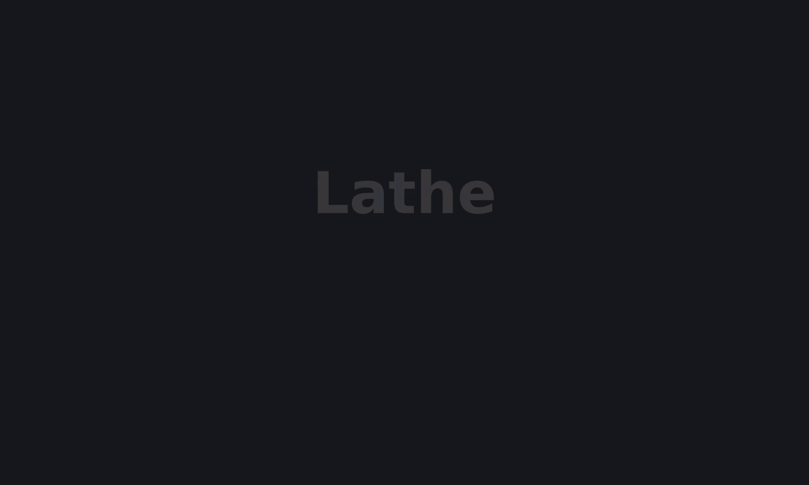

# Lathe

[](https://central.sonatype.com/artifact/io.github.ag-libs/lathe-maven-extension)
[](https://github.com/ag-libs/lathe/actions/workflows/ci.yml)

**A Java language server that gets its project setup from your build. No project import, no classpath configuration.**



<!-- The GIF filename carries a content hash (docs/demo-<hash>.gif) so browsers never serve a stale
     cached copy: dev/demo/record.sh regenerates it, renames it by content hash, deletes the previous
     one, and rewrites the link above. Do not hand-edit the hash. Recorded against the public
     com.example multi-module fixture. -->

## Why Lathe

Most Java language servers build their own model of your project, and it drifts from what your build actually does.
Lathe doesn't keep a separate model.
When you build, Lathe [records how the build compiles, tests and runs each module](docs/guide/how-it-works.md#build-capture), and the editor uses exactly that.

- **The editor agrees with your build.**
  Errors come from the JDK's own compiler with your build's flags.
  Modular projects, annotation processors and generated sources work without extra setup.
- **Run, test and debug without rebuilding.**
  Lathe runs your `main` methods and tests the way your build runs them (same classpath, module path and flags), from the classes it already compiled.
  This is in the Neovim client today.
- **Works across the whole project.**
  Navigation, references and rename cover every module, and navigation also steps into your dependencies' sources and the JDK's.
- **Keeps up with outside changes.**
  After a branch switch, a `git pull` or an AI agent's edits, Lathe recompiles the changed files on its own.
- **Gives AI agents the same view.**
  An [MCP server](docs/guide/ai-agents.md) lets coding agents use the compiler's answers instead of guessing with `grep`.

See the full [feature list](docs/guide/features.md), or the [Neovim keymap reference](docs/guide/editors/neovim.md#lsp-actions) for each feature with its default and suggested key.

## Quick start

You need Java 17+, Maven 3.6.3+ and `maven-compiler-plugin` 3.6.2+ (see [requirements](docs/guide/installation.md#requirements)).

**1. Add Lathe to your build.** Put this in `.mvn/extensions.xml` at the root of your project (or under `<build><extensions>` in the root `pom.xml`):

```xml
<extensions>
  <extension>
    <groupId>io.github.ag-libs</groupId>
    <artifactId>lathe-maven-extension</artifactId>
    <version>0.1.23</version>
  </extension>
</extensions>
```

**2. Build once.** This records your project's setup without running the tests:

```bash
mvn clean test -Dlathe.capture.only=true
```

Add `.lathe/` to your `.gitignore`.
After this, every normal build keeps Lathe up to date.

**3. Set up your editor** using its guide below.

More options, including setup without the extension, are in the [installation guide](docs/guide/installation.md).

## Editors

| Editor           | Support                                                                                                                  | Guide                                                                     |
|------------------|--------------------------------------------------------------------------------------------------------------------------|---------------------------------------------------------------------------|
| Neovim           | Full client: LSP plus run, test, debug and new-type scaffolding                                                          | [Neovim](docs/guide/editors/neovim.md) · [example config](examples/nvim/) |
| VS Code / Cursor | "Lathe for Java" extension ([`.vsix` on each release](https://github.com/ag-libs/lathe/releases), preview, standard LSP) | [VS Code](docs/guide/editors/vscode.md)                                   |
| Emacs            | Built-in [Eglot](https://www.gnu.org/software/emacs/manual/html_mono/eglot.html), no plugin needed                       | [Emacs](docs/guide/editors/emacs.md)                                      |
| Zed              | The [Java extension](https://github.com/zed-extensions/java), plus one settings file                                     | [Zed](docs/guide/editors/zed.md)                                          |

Lathe is a standard language server, so other LSP clients can use it too.

## AI agents

`lathe-mcp-server` gives coding agents such as Claude Code the same analysis over the [Model Context Protocol](https://modelcontextprotocol.io/).
Agents can check diagnostics, find references, rename across modules, run tests, and verify a change without a full build.
See the [AI agents guide](docs/guide/ai-agents.md).

## Status

Lathe is in active development and published to [Maven Central](https://central.sonatype.com/namespace/io.github.ag-libs).

- **Builds:** Maven, and the [OpenJDK `make` build](docs/guide/openjdk.md). Gradle support arrives in 0.2.0 (see the [Gradle guide](docs/guide/gradle.md)).
- **Platforms:** Linux, macOS and Windows 10/11. On Windows, use VS Code, Cursor or Zed.
- **Editors:** Neovim has the full feature set. The other editors get the standard LSP features; run, test and debug are Neovim-only for now.

What works today, in detail, is in [status](docs/status.md).

## Documentation

- [How Lathe works](docs/guide/how-it-works.md)
- [Features](docs/guide/features.md)
- [Installation](docs/guide/installation.md), including how to turn Lathe off
- [Gradle](docs/guide/gradle.md), from 0.2.0
- [Run configuration](docs/guide/run-configuration.md) and [test capture](docs/guide/test-capture.md)
- [Troubleshooting](docs/guide/troubleshooting.md)
- Project: [roadmap](docs/roadmap.md) · [design index](docs/design-index.md)

## Contributing

Feedback, bug reports, and questions are welcome: please [open an issue](https://github.com/ag-libs/lathe/issues).
Lathe isn't accepting code contributions at the moment, so please open an issue rather than a pull request; see [CONTRIBUTING.md](CONTRIBUTING.md).
Thank you for trying Lathe.

Lathe is developed with AI coding tools, mainly Claude Code.
A maintainer reviews every change and takes responsibility for it, and AI-assisted commits carry a `Co-Authored-By` trailer.
This follows the [Apache Software Foundation's guidance](https://www.apache.org/legal/generative-tooling.html) on generative tools.

## License

[Apache License 2.0](LICENSE)
