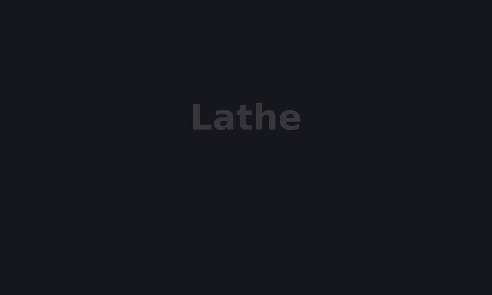

# Lathe

[](https://central.sonatype.com/artifact/io.github.ag-libs/lathe-maven-extension)
[](https://github.com/ag-libs/lathe/actions/workflows/ci.yml)

Lathe is a Java language server that doesn't import your project.
It watches your build compile and records the classpath, flags and module setup for every module, then runs javac with exactly that.
So the errors in your editor are the errors your build gives, including on projects with annotation processors, Lombok or generated sources.
AI coding agents get the same answers through an MCP server.



<!-- The GIF filename carries a content hash (docs/demo-<hash>.gif) so browsers never serve a stale
     cached copy: dev/demo/record.sh regenerates it, renames it by content hash, deletes the previous
     one, and rewrites the link above. Do not hand-edit the hash. Recorded against the public
     com.example multi-module fixture. -->

## What you get

**In the editor.**
Errors and warnings come from the JDK's compiler with your build's flags.
Go to definition, find references and rename work across every module in the build, and navigation steps into your dependencies' sources and the JDK's.
Extract method, variable, constant and field are there too; extract method compiles its result before you apply it.
In Neovim you can also run a `main` method, run or debug a test, and scaffold a new type, all from the classes the build already compiled, so there is no rebuild first.

**For AI coding agents.**
An MCP server exposes the same engine to Claude Code and other agents.
The agent can check diagnostics on the real classpath, find every real use of a symbol and who implements or overrides it, rename across the build, run a single test without a build, and check that an edit still compiles, callers included.
These are the operations `grep` gets wrong on a multi-module project.

**How it stays correct.**
When you build, Lathe records how each module is compiled, tested and run.
The editor and the agent read that record, so there is no second project model to drift from the build.
After a branch switch, a `git pull` or an agent's edits, Lathe recompiles the changed files on its own.
See [how Lathe works](docs/guide/how-it-works.md) and the full [feature list](docs/guide/features.md).

## Quick start

You need Java 17 or newer, and Maven 3.6.3+ or Gradle 8.8+ (details for [Maven](docs/guide/maven.md#requirements) and [Gradle](docs/guide/gradle.md#requirements)).

There are two ways to set a project up.
The first does not change your build files.

### From Neovim, without touching the build

Install the [lathe.nvim plugin](docs/guide/editors/neovim.md#install), open any file of the project and run:

```
:LatheInit
```

It finds the build's root and asks you to confirm it, then runs one clean build that records how each module is compiled and tested, without running the tests.
Lathe is passed to that build from outside, so nothing in your project changes.
Compile errors don't stop it.
When the build ends the server attaches.
Later, `:LatheSync` refreshes the workspace; a build you run yourself from the shell doesn't, because it runs without Lathe.

### By registering Lathe in the build

Use this if you want Lathe for everyone on the project, for an editor other than Neovim, or so that every build refreshes Lathe on its own.
Registered in the build, Lathe records each module as it compiles, for the cost of a directory walk and a copy of the module's classes, typically well under a second ([details](docs/guide/how-it-works.md#build-capture)).

Maven: put this in `.mvn/extensions.xml` at the root of your project (or under `<build><extensions>` in the root `pom.xml`):

```xml
<extensions>
  <extension>
    <groupId>io.github.ag-libs</groupId>
    <artifactId>lathe-maven-extension</artifactId>
    <version>0.3.1</version>
  </extension>
</extensions>
```

Gradle: apply the settings plugin in `settings.gradle.kts`:

```kotlin
plugins {
    id("io.github.ag-libs.lathe") version "0.3.1"
}
```

Then build once.
This records the project's setup without running the tests:

```bash
mvn clean test -Dlathe.capture.only=true               # Maven
./gradlew latheSync -Plathe.capture.only=true          # Gradle
```

Maven prints `[WARNING]` lines about skipped tests and unresolved reactor modules; they are expected ([why](docs/guide/test-capture.md)).
After this, every build keeps `.lathe/` current, whoever runs it and from wherever.

Either way, the build writes a `.lathe/` directory next to your sources.
It ignores itself in git.
Setup without the extension, Gradle's personal init script, and turning Lathe off are in the [Maven](docs/guide/maven.md) and [Gradle](docs/guide/gradle.md) guides.

Now set up your [editor](#editors) or your [AI agent](#ai-agents).

## Editors

| Editor           | What you get                                                                                              | Guide                                                                             |
|------------------|-----------------------------------------------------------------------------------------------------------|-----------------------------------------------------------------------------------|
| Neovim           | Everything: LSP, plus run, test, debug, new-type scaffolding and `:LatheInit`                             | [Neovim](docs/guide/editors/neovim.md#install) · [example config](examples/nvim/) |
| VS Code / Cursor | Standard LSP through the "Lathe for Java" extension ([`.vsix` on each release](https://github.com/ag-libs/lathe/releases), preview) | [VS Code](docs/guide/editors/vscode.md)                                           |
| Emacs            | Standard LSP through the built-in [Eglot](https://www.gnu.org/software/emacs/manual/html_mono/eglot.html), no plugin needed | [Emacs](docs/guide/editors/emacs.md)                                              |
| Zed              | Standard LSP through the [Java extension](https://github.com/zed-extensions/java), plus one settings file | [Zed](docs/guide/editors/zed.md)                                                  |

Lathe is a standard language server, so any other LSP client can use it too.
On Windows, use VS Code, Cursor or Zed.

## AI agents

The build's sync step writes an MCP launcher into `.lathe/`, so there is nothing more to install.
From the project root, register it with Claude Code:

```bash
claude mcp add --transport stdio lathe -- .lathe/lathe-mcp-launcher.sh
```

The agent then has `get_diagnostics`, `find_references`, `find_implementations`, `rename_symbol`, `run_test`, `verify_change` and a few more, all answered by the compiler on the build's classpath.
Other agents, a single registration for every project, and what each tool does are in the [AI agents guide](docs/guide/ai-agents.md).

## Status

Lathe is in active development and published to [Maven Central](https://central.sonatype.com/namespace/io.github.ag-libs).

- **Builds:** [Maven](docs/guide/maven.md), [Gradle](docs/guide/gradle.md), and the [OpenJDK `make` build](docs/guide/openjdk.md).
- **Platforms:** Linux, macOS and Windows 10/11.
- **Editors:** Neovim has the full feature set; run, test and debug are Neovim-only for now.

What works today, in detail, is in [status](docs/status.md).

## Documentation

- [How Lathe works](docs/guide/how-it-works.md)
- [Features](docs/guide/features.md)
- [Installation](docs/guide/installation.md): the build, the editor clients, the server JVM and JDK
- [Maven](docs/guide/maven.md), including how to turn Lathe off
- [Gradle](docs/guide/gradle.md)
- [OpenJDK](docs/guide/openjdk.md)
- [AI agents](docs/guide/ai-agents.md)
- [Run configuration](docs/guide/run-configuration.md) and [test capture](docs/guide/test-capture.md)
- [Troubleshooting](docs/guide/troubleshooting.md)
- Project: [roadmap](docs/roadmap.md) · [design index](docs/design-index.md)

## Contributing

Feedback, bug reports, and questions are welcome: please [open an issue](https://github.com/ag-libs/lathe/issues).
Lathe isn't accepting code contributions at the moment, so please open an issue rather than a pull request; see [CONTRIBUTING.md](CONTRIBUTING.md).
Thank you for trying Lathe.

Lathe is developed with AI coding tools, mainly Claude Code.
A maintainer reviews every change and takes responsibility for it, and AI-assisted commits carry a `Co-Authored-By` trailer.
This follows the [Apache Software Foundation's guidance](https://www.apache.org/legal/generative-tooling.html) on generative tools.

## License

[Apache License 2.0](LICENSE)
